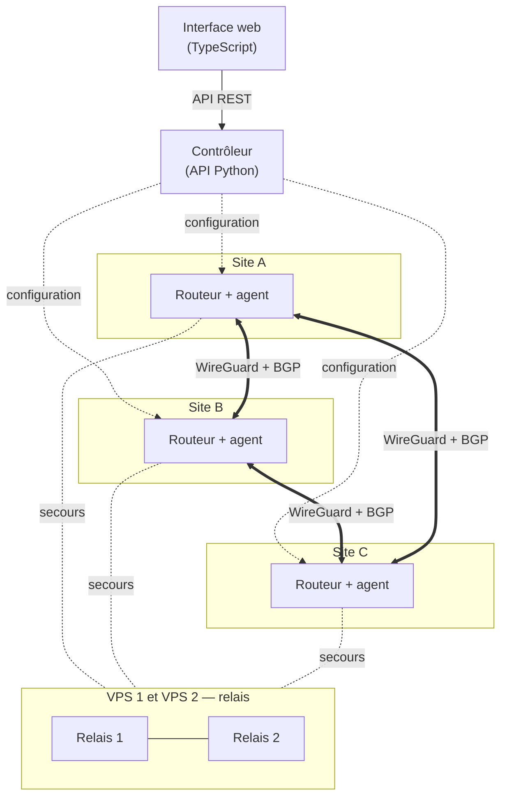

# h42-mesh

> Relier ses maisons comme un seul réseau, où qu'elles soient.
> *h42 pour Home42 : des solutions qui ont la réponse à la grande question… du réseau domestique.*

**h42-mesh** est un VPN maillé auto-hébergé qui relie plusieurs sites (des maisons réparties en France, par exemple) en un réseau unique, résilient et routé dynamiquement. Chaque site peut disposer d'un ou deux routeurs, et chaque routeur de plusieurs connexions internet (fibre, 4G, 5G, Starlink…).

> **Statut : en conception.** L'architecture est arrêtée, le développement démarre. Rien n'est encore prêt pour la production.

## Pourquoi h42-mesh ?

Les solutions existantes (Netbird, Headscale, Nebula…) relient très bien des **appareils**. h42-mesh relie des **sites entiers** :

- plusieurs connexions internet par routeur, avec une précédence **active / secours** toujours respectée ;
- deux routeurs par site, en redondance ;
- routage dynamique **BGP**, un AS par site ;
- tunnels **directs** dès que c'est possible, **relais** par des VPS sinon ;
- contrôle total : tout est auto-hébergé, rien ne dépend d'un service tiers.

## Fonctionnalités prévues

- **Maillage WireGuard** entre les sites, dans le noyau Linux.
- **Tunnels directs intelligents** : un tunnel est possible dès qu'un seul des deux côtés accepte les connexions entrantes. IPv6 privilégiée, IPv4 sinon, relais en dernier recours.
- **Relais et secours** par deux VPS dans des datacenters distincts, joignables en IPv4 et IPv6.
- **Routage BGP avec FRR** : un AS privé sur 4 octets par site, communautés BGP larges pour propager la précédence active/secours.
- **Bascule rapide** : BFD sur les tunnels actifs (moins d'une seconde), temporisations économes sur les liens de secours ou facturés au volume.
- **Redondance de site** : VRRP avec keepalived et iBGP entre les deux routeurs.
- **Enrôlement sécurisé** : jeton à usage unique, clés générées sur le routeur, authentification par JWT signé (EdDSA).
- **Interface web** pour piloter et visualiser le réseau.

## Architecture



Le contrôleur **configure** le réseau, il ne fait pas passer le trafic : si le contrôleur tombe, les tunnels établis continuent de fonctionner.

### Composants

| Composant | Rôle | Technologies |
| --- | --- | --- |
| `controller/` | API : inventaire des sites, routeurs et connexions, attribution des adresses et des AS, distribution de la configuration | Python, FastAPI, Pydantic, Tortoise ORM, SQLite / PostgreSQL |
| `agent/` | Service sur chaque routeur et VPS : applique la configuration, pilote WireGuard, FRR et keepalived, remonte l'état des liens | Python, pyroute2, Jinja2, systemd |
| `gui/` | Interface web, simple client de l'API | TypeScript, React, Vite, Mantine, TanStack Query, React Flow |

Le pare-feu entre zones réseau (utilisateurs, domotique, invités, vidéosurveillance, IoT…) et l'adressage des réseaux locaux relèvent d'une **application complémentaire** distincte.

## Concepts clés

### Connexions

Chaque connexion internet est déclarée avec :

| Attribut | Description |
| --- | --- |
| Rôle | `active` ou `secours` ; une connexion de secours a toujours une priorité moindre |
| Priorité | Optionnelle, départage les connexions d'un même rôle |
| Connexion directe possible | Par famille d'adresses (IPv4, IPv6) : la connexion peut-elle recevoir des tunnels ? |
| Plage de ports IPv4 | Optionnelle, pour les IPv4 partagées |
| Facturée au volume | Optionnel, réduit le trafic de fond |
| Type | Informatif (fibre, 4G, 5G, Starlink…) |

### Ordre de préférence des chemins

1. Direct, active ↔ active
2. Via VPS, sur connexions actives
3. Direct, impliquant une connexion de secours
4. Via VPS, impliquant une connexion de secours

### Numéros d'AS

| Équipement | AS |
| --- | --- |
| Sites | `4200000001`, `4200000002`, … |
| VPS 1 / VPS 2 | `4200000101` / `4200000102` |

Plage privée sur 4 octets (RFC 6996). Oui, elle commence par 42.

## Prérequis

- **Routeurs** : Debian, x86_64 ou arm64.
- **VPS** : Debian 13, Podman (Quadlet), Traefik, IPv4 et IPv6 publiques.
- **Logiciels** : WireGuard, FRR, keepalived, Python 3.

## Structure du dépôt

```
h42-mesh/
├── controller/   # API du contrôleur (Python)
├── agent/        # Agent des routeurs et VPS (Python)
├── gui/          # Interface web (TypeScript)
└── docs/         # Documentation
```

## Feuille de route

- [ ] **Fondations** : modèle de données et API du contrôleur, enrôlement par jeton, authentification JWT, déploiement Podman et Traefik
- [ ] **Premier tunnel** : deux routeurs reliés par l'agent à partir de la configuration du contrôleur
- [ ] **VPS en relais** : tunnels vers les deux VPS et sessions BGP avec FRR
- [ ] **Maillage et précédence** : tunnels directs, précédence active/secours avec communautés BGP, BFD
- [ ] **Redondance de site** : deux routeurs avec keepalived et iBGP
- [ ] **Haute disponibilité** du contrôleur avec PostgreSQL répliqué, puis interface web avec double authentification

## Sécurité

- Les clés privées (WireGuard et signature Ed25519) sont générées sur chaque routeur et ne le quittent jamais.
- Les agents s'authentifient par des JWT de courte durée qu'ils signent eux-mêmes ; un routeur se révoque en désactivant sa clé publique.
- Le trafic relayé par un VPS y est déchiffré puis rechiffré : utilisez des protocoles chiffrés de bout en bout pour les flux sensibles.

Pour signaler une vulnérabilité, merci de ne pas ouvrir de ticket public et de contacter directement les mainteneurs.

## Contribuer

Le projet est en phase de conception : les retours sur l'architecture sont les bienvenus via les tickets du dépôt.

## Licence

h42-mesh est distribué sous licence [MIT](LICENSE).
